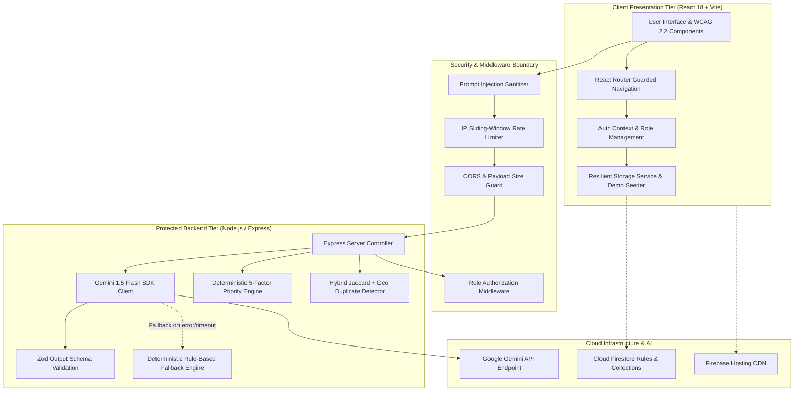
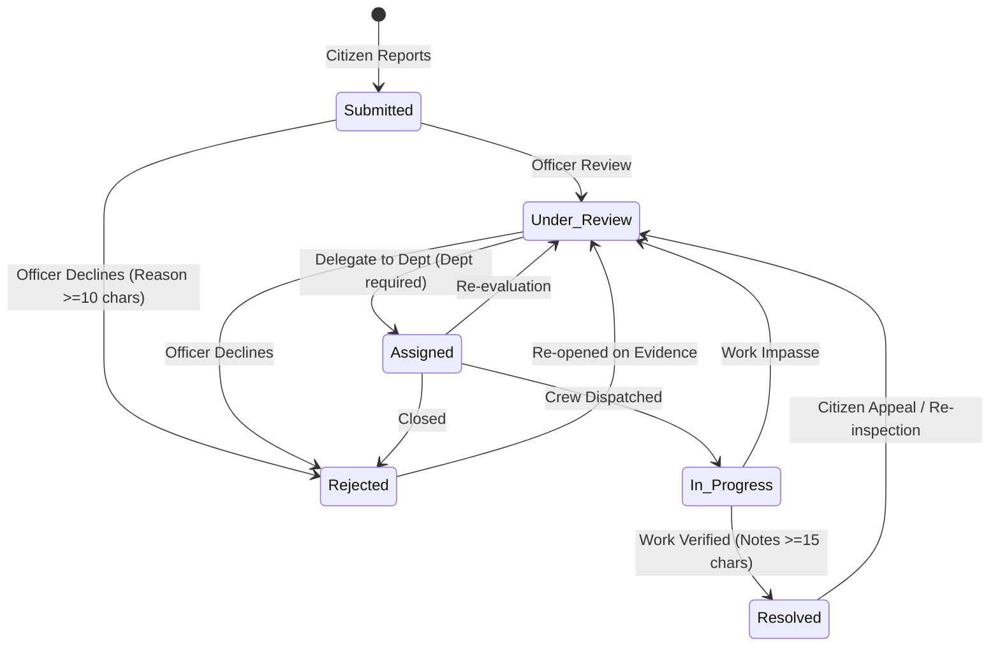

# CivicPulse AI — System Architecture & Design Specification

## 1. Architectural Overview

CivicPulse AI is engineered with a modular, decoupled architecture that isolates client-side presentation, municipal business rules, server-side privileged operations, and AI intelligence pipelines.



---

## 2. Core Subsystems

### A. Client Presentation Layer (`src/`)
- **Reactive Role Context**: Employs React Context (`AuthContext`) managing citizen, officer, and administrator user sessions with immediate local persistence.
- **Accessible UI Primitives**: Standardized components (`Button`, `Modal`, `Badge`, `Alert`, `SkipLink`) adhering strictly to WCAG 2.2 AA standards with high-contrast outlines and semantic ARIA attributes.
- **Route Authorization Guards**: `<ProtectedRoute>` prevents unauthorized access to privileged portals while providing clear feedback and one-click role switching.

### B. Secure Server-Side AI Gateway (`server/src/`)
Privileged Google Gemini API credentials (`GEMINI_API_KEY`) reside exclusively on the server and are never exposed to browser bundles.
- **Prompt Injection Defense**: All complaint texts pass through `sanitizeComplaintText` stripping malicious tokens (`ignore previous instructions`, `DAN mode`, script tags).
- **Zod Schema Enforcement**: Gemini model completions are parsed against `AIAnalysisSchema`. Malformed responses trigger an automated error-recovery pipeline.
- **Zero-Downtime Deterministic Fallback**: If the Gemini API experiences network disruption, rate limits, or missing keys, the system transparently executes rule-based triage (`generateDeterministicRuleAnalysis`), explicitly labeling output with `isFallback: true`.

### C. Deterministic Priority Engine (`src/lib/priorityEngine.ts`)
Municipal complaints are prioritized on a calibrated 0–100 scale:
$$\text{Score} = \text{Safety} (0\text{--}35) + \text{Community} (0\text{--}20) + \text{Aging} (0\text{--}15) + \text{Severity} (0\text{--}20) + \text{Evidence} (0\text{--}10)$$

Every calculation records a detailed `PriorityScoreBreakdown` and human-readable explanation, ensuring public accountability and regulatory compliance.

### D. Duplicate Detection Engine (`src/lib/duplicateEngine.ts`)
Detects overlapping complaints through multi-factor correlation:
- **Text Token Overlap**: Tokenizes complaints into non-stopword sets and evaluates Jaccard similarity.
- **Category Compatibility**: Weights identical municipal classifications.
- **Geographic Proximity**: Calculates spherical distance via the Haversine formula ($\le 200\text{m} = +0.35$ weight, $> 5\text{km} = -0.30$).
- **Report Timing**: Flags complaints submitted within 48 hours.

**Human Confirmation Policy**: The engine presents candidate duplicates to municipal officers with similarity percentages and matching rationale; automatic merging is strictly prohibited.

---

## 3. Auditable Status State Machine

The status transition state machine enforces valid municipal workflow order:



---

## 4. Data Storage Model

```typescript
CivicReport {
  id: string                      // e.g. "CP-2026-0001"
  citizenId: string               // Owner UID
  citizenEmail: string
  citizenName: string
  title: string
  description: string
  category: IssueCategory         // pothole | water_leakage | garbage | ...
  urgency: IssueUrgency           // low | medium | high | critical
  location: LocationData          // address, latitude, longitude, landmark
  imageUrl?: string               // Base64 or Cloud Storage URL
  status: ReportStatus            // submitted | under_review | assigned | in_progress | resolved | rejected
  statusHistory: StatusHistory[]  // Timestamped audit event trail
  priorityScore: PriorityScore    // Deterministic 0-100 score + factor breakdown
  aiAnalysis?: AIAnalysisResult   // Gemini structured suggestions
  duplicateCheck?: DuplicateCheck // Suspected matches + similarity scores
  assignedDepartment?: string     // e.g. "Department of Transportation"
  resolutionNotes?: string        // Mandatory for resolved status
  rejectedReason?: string         // Mandatory for rejected status
  createdAt: string
  updatedAt: string
}
```
